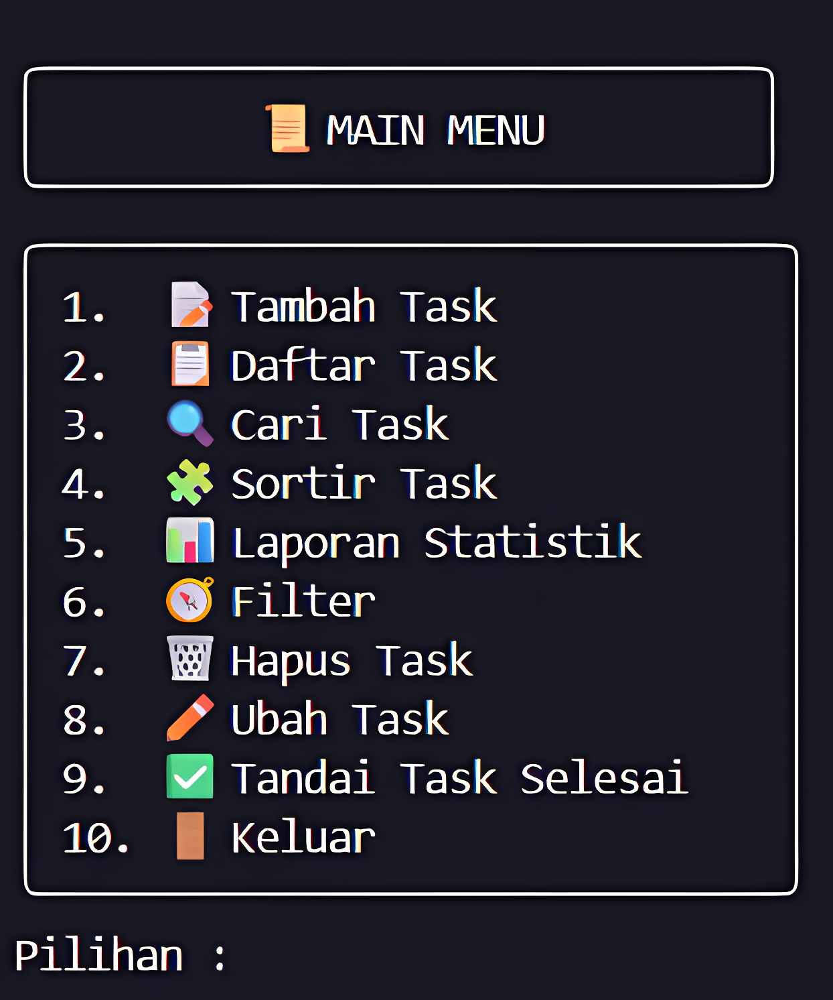

English | [Bahasa Indonesia](READMEid.md) | [中文](READMECN.md)
# TaskMaster CLI: Python Task Management System


A comprehensive, command-line based task management application built with Python. This tool allows users to efficiently add, track, filter, and manage their daily tasks and schedules directly from the terminal. Designed as a school project, it demonstrates core programming concepts including data manipulation, modular design, and user-friendly command-line interaction.

## ✨ Key Features

-   **Full CRUD Functionality**: Add, view, update, and delete tasks with ease.
-   **Advanced Sorting**: Sort tasks by **deadline**, **name**, **priority**, or **status** in both ascending and descending order.
-   **Smart Filtering**: Dynamically filter tasks by various time periods (`today`, `tomorrow`, `this week`, `this month`), priority, or status.
-   **Task Prioritization**: Instantly view the "Top 3 Most Important Tasks" based on a combination of priority and upcoming deadlines.
-   **Quick Actions**: Easily mark tasks as "Completed" or delete all finished tasks at once.
-   **Statistical Reporting**: Generate a detailed and beautifully formatted report including total tasks, status breakdowns, and priority statistics.
-   **User-Friendly Interface**: A simple and intuitive menu-driven interface for seamless navigation.
-   **Dynamic Table Formatting**: Task lists are displayed in neatly formatted tables that adjust to the content length.

## 📸 Demo

Here's a quick look at the new main menu and the formatted task list output:

**Main Menu:**




**Sample Output (`Daftar Task`):**
```
──────────────────────────────────────────────────────────────────────────────────
                                   Semua Task
──────────────────────────────────────────────────────────────────────────────────
ID │ Task                      │ Deadline              │ Priority │ Status
──────────────────────────────────────────────────────────────────────────────────
1  │ Kerjakan Tugas Basis Data │ 2025 05 October 13:00 │ High     │ Pending
2  │ Belajar Algoritma         │ 2025 06 October 12:57 │ Medium   │ In Progress
3  │ Buat Slide Presentasi     │ 2025 08 October 16:49 │ High     │ Completed
4  │ Rapat Tim                 │ 2025 04 October 15:00 │ Low      │ Completed
5  │ Kerjakan Tugas Pbo        │ 2025 04 October 15:00 │ High     │ Completed
──────────────────────────────────────────────────────────────────────────────────
```

## 📂 Project Structure

The project is organized into modular files for better readability and maintenance.

```
your-project-name/
├── main.py                     # Main entry point of the application
└── helpers/
    ├── __init__.py
    ├── addData.py              # Handles logic for adding new tasks
    ├── changeData.py           # Functions for updating, deleting, and marking tasks as complete
    ├── dataFilters.py          # Functions for filtering tasks and displaying the data table
    ├── reports.py              # Generates and prints the statistical report
    ├── search.py               # Implements the task search functionality
    └── sorter.py               # Contains all functions for advanced task sorting
```

## 🚀 Getting Started

Follow these instructions to get a copy of the project up and running on your local machine.

### Prerequisites

-   Python 3.8 or higher

### Installation & Running

1.  **Clone the repository (or download the files):**
    ```sh
    git clone [https://github.com/Yoruxyv/your-repo-name.git](https://github.com/Yoruxyv/your-repo-name.git)
    ```
2.  **Navigate to the project directory:**
    ```sh
    cd your-repo-name
    ```
3.  **Run the application:**
    ```sh
    python main.py
    ```
    The application will start, and you can navigate through the features using the on-screen menu.

## 🛠️ Code Modules Overview

-   **`main.py`**: The main driver of the application. It displays the primary menu and handles user input to call functions from the helper modules.
-   **`helpers/addData.py`**: Contains the `tambah_task` function. It prompts the user for task details, validates input (e.g., checks for duplicate names and valid dates), and adds new tasks to the list.
-   **`helpers/changeData.py`**: A module for modifying tasks. It includes functions to update specific fields of a task (`ubah_task`), delete a specific task (`hapus_data`), mark a task as complete (`selesaikan_task`), and clear all completed tasks (`hapus_task_selesai`).
-   **`helpers/dataFilters.py`**: A core module that includes functions to filter tasks by various timeframes, priority, and status. It also contains the crucial `data_task` function for displaying all data in a clean, dynamically sized table.
-   **`helpers/reports.py`**: Contains the `laporan_statistik` function, which calculates and prints a summary report in a formatted box.
-   **`helpers/search.py`**: Implements the `cari_task` functionality to find and display tasks based on a keyword search.
-   **`helpers/sorter.py`**: Provides a comprehensive set of sorting functions. It can sort tasks by deadline, name, priority, or status in both ascending and descending order.

## 👤 Contributors

<table border="0" cellspacing="10" cellpadding="5">
  <tr>
    <td align="center" style="border: 1px solid #555; padding: 10px;">
      <a href="https://github.com/Jess2Jes">
        
      </a>
      <br/>
      <a href="https://github.com/Jess2Jes">Jess2Jes</a>
    </td>
    <td align="center" style="border: 1px solid #555; padding: 10px;">
      <a href="https://github.com/Yoruxyv">
        
      </a>
      <br/>
      <a href="https://github.com/Yoruxyv">Hans 展豪</a>
    </td>
    <td align="center" style="border: 1px solid #555; padding: 10px;">
      <a href="https://github.com/Solynixx">
        
      </a>
      <br/>
      <a href="https://github.com/Solynixx">Solynixx</a>
    </td>
    <td align="center" style="border: 1px solid #555; padding: 10px;">
      <a href="https://github.com/StevNard">
        
      </a>
      <br/>
      <a href="https://github.com/StevNard">StevNard</a>
    </td>
    <td align="center" style="border: 1px solid #555; padding: 10px;">
      <a href="https://github.com/Milkdrinker-creator">
        
      </a>
      <br/>
      <a href="https://github.com/Milkdrinker-creator">Milkdrinker-creator</a>
    </td>
        <td align="center" style="border: 1px solid #555; padding: 10px;">
      <a href="https://github.com/Azelezasl">
        
      </a>
      <br/>
      <a href="https://github.com/Azelezasl">Azelezasl</a>
    </td>
    
  </tr>
</table>